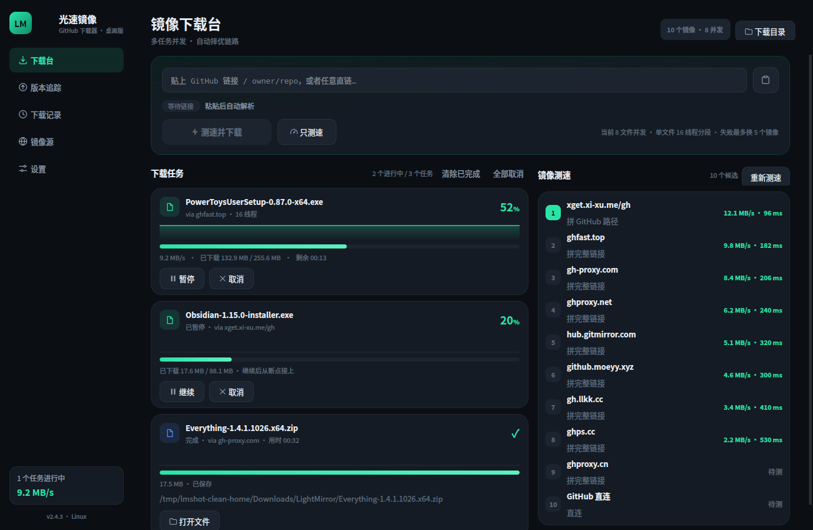
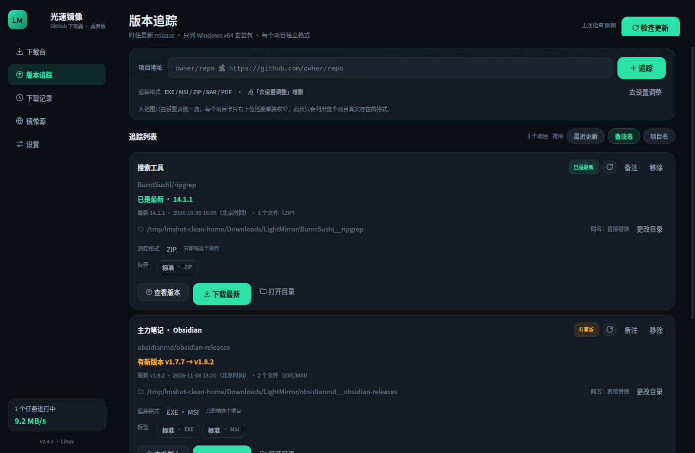
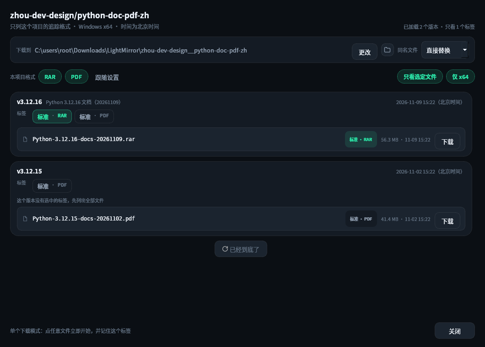
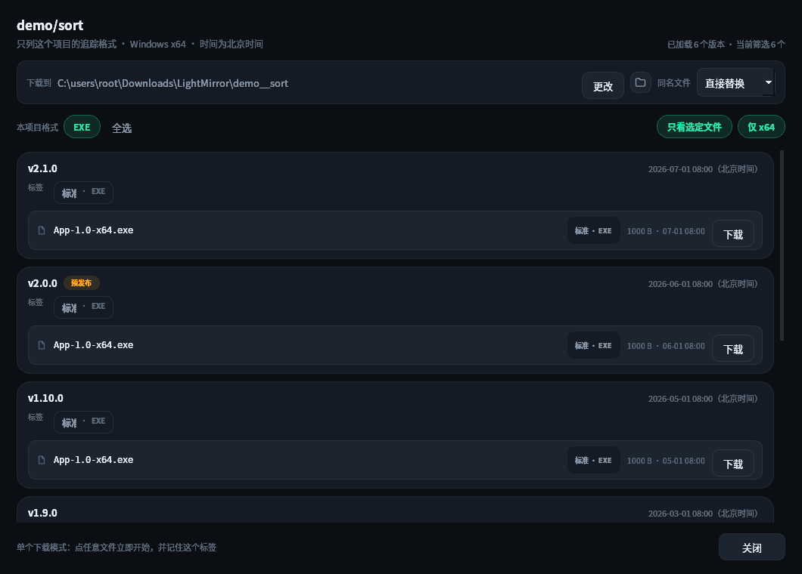
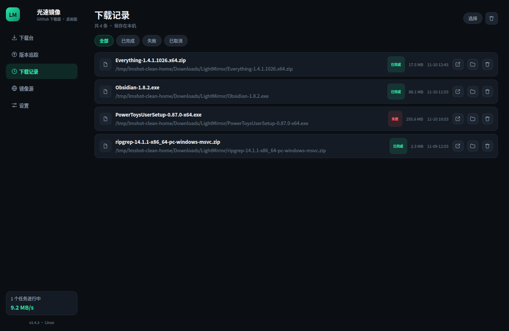
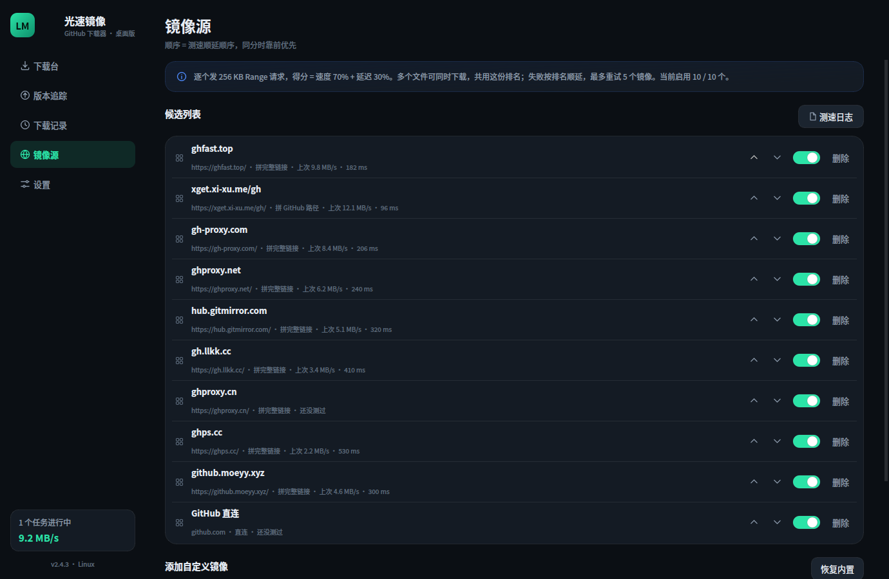
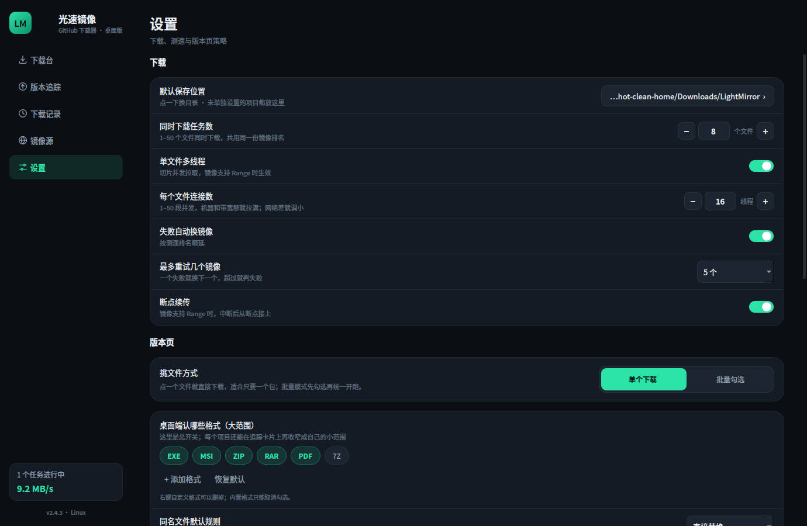
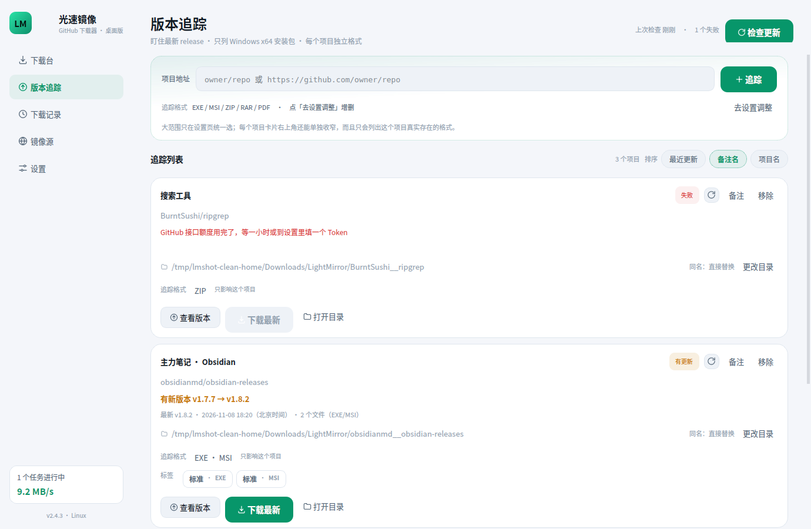
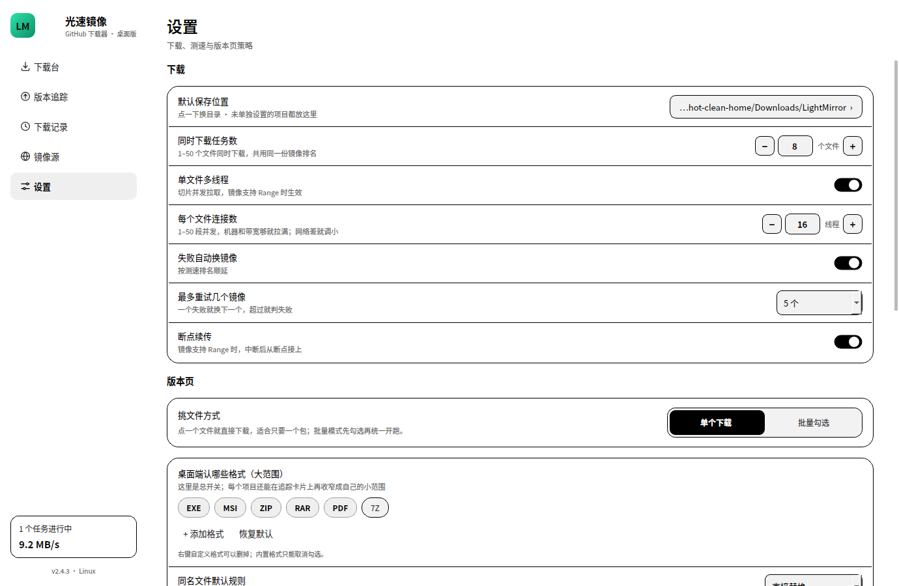

# 光速镜像 · 桌面版（LightMirror Desktop）

把安卓端「光速镜像」的界面语言和下载逻辑搬到电脑上：**粘贴 GitHub 链接 → 逐个镜像测速 → 只走最快的那条链路下载**。
单文件 Windows 程序，Python + PySide6 编写，不需要安装运行库，也没有任何外部服务依赖。

| 交付物 | 说明 |
| --- | --- |
| `LightMirror-Desktop-2.4.3.exe` | Windows 单文件程序，双击即用（35 MB，含 Python 与 Qt 运行时） |
| `lightmirror.py` | 完整源码，一个文件；`python lightmirror.py` 直接运行 |
| `screenshots/` | 深色 / 浅色 / 黑白三套主题与各页面截图 |
| `build_exe.bat` | 在 Windows 上一键重新打包 EXE |
| `assets/lightmirror.ico` · `version_info.txt` | 图标与 EXE 版本信息 |

---

## 一、和手机版一致的部分

- **五个页面**：下载台 / 版本追踪 / 下载记录 / 镜像源 / 设置。手机上的底部页签，在桌面端变成左侧导航栏。
- **版本列表按发布时间倒序**：以 GitHub 的 `published_at` 为准从新到旧，时间相同再比版本号数字（`v1.10` 排在 `v1.9` 前面），翻页合并时自动去重，不会出现新旧交错或同一条重复两次。
- **下载前必先测速**：不管是首页「测速并下载」，还是版本追踪里的「下载最新」「单个下载」「批量下载」，都会先把启用的镜像逐个测一遍，测完才按得分（速度 70% + 延迟 30%）挑最快的那条开跑；等测速的过程中按钮显示「测速中…」，连点多次也不会丢请求，会排队等这一轮测速结束一起放行。
- **失败顺延**：一个镜像失败自动换下一个，可在 1–10 之间设置最多重试几个。
- **并发下载**：同时下载 1–50 个文件；单个文件再切 1–50 段并发拉，支持断点续传、暂停、继续、取消。
- **三套主题**：深空（深色）/ 纸白（浅色）/ 黑白（墨水屏），设置里即时切换。
- **下载记录**：多选、全选、删除选中；删除时可选「只删记录」或「记录和文件一起删」。
- **镜像源管理**：启用 / 停用、上下排序、删除、恢复内置、添加自定义镜像（拼完整链接 / 拼 GitHub 路径两种模式）。



---

## 二、桌面端单独适配的两个功能

### 1. 默认只看 EXE / MSI / ZIP / RAR / PDF，不再管 APK

版本追踪页和版本弹层默认只显示 **EXE、MSI、ZIP、RAR、PDF** 五类，7Z 可选；APK 从桌面端默认选项里彻底移除。

- **大范围只在「设置 → 桌面端认哪些格式」里改**：多选、随时增删，`+ 添加格式` 可以加 `iso`、`epub`，右键自定义格式可删除，「恢复默认」一键回到五类。
- 追踪页顶部只显示当前范围（点「去设置调整」直接跳过去），不再重复放一排可点的格式块，免得和项目级的小范围搞混。
- 追踪卡片上的「N 个文件（EXE/ZIP）」都按这套格式计算，`x64 / amd64` 优先于 `arm64 / x86`。
- 调试符号（`symbols-*.zip`）、校验和、`.sig` 这类附件默认不参与列表和标签，免得把有用的包挤下去。

### 2. 每个项目独立下载目录 + 同名替换规则

版本追踪里每一个项目都有自己的一行「下载到 …」：

- 默认目录：`<默认下载根>\<owner__repo>`，点「更改」可以单独指定，例如 `D:\Installers\PowerToys`。
- 同名规则（每个项目可单独覆盖）：
  - **直接替换**：先写 `.part`，下完再原子替换旧文件，失败不会毁掉原文件；
  - **自动改名**：保留旧文件，新文件加 `(1)`；
  - **跳过不下载**：目录里已有同名文件就不再下；
  - **每次询问**：真正开始前弹窗选一次，批量下载时只问一次。
- 全局默认规则在「设置 → 版本页 → 同名文件默认规则」，项目没有单独设置时用它。
- 追踪卡片和版本弹层都显示当前目录与规则，随时可改。



### 3. 项目备注名 + 三种排序（2.2 新增）

- 每张追踪卡片右上角有「备注」，点一下就能给项目起名字，例如「主力笔记 · Obsidian」；留空恢复显示 `owner/repo`。
- 备注写入 `state.json`，重启后仍在；有备注时卡片标题显示备注，下面一行小字保留真实仓库地址。
- 追踪列表右上角三个排序标签，选择会记住：
  - **最近更新**：按最新 Release 的发布时间倒序，刚发版的项目排最前；
  - **备注名**：按备注名（没写备注时用仓库名）排序，中文按拼音、英文按字母；
  - **项目名**：按仓库名排序。

### 4. 标签：格式 + 差异，选中一个就只下它（2.3 新增）

标签由两段组成：**格式**（EXE / MSI / ZIP / RAR / PDF）和**差异**——把同格式文件里相同的产品名、版本号、架构都去掉之后剩下的部分。差异是**按格式分组**算的，不同格式互不干扰：

| 项目 | 文件 | 标签 |
| --- | --- | --- |
| microsoft/PowerToys | `PowerToysSetup-0.103.3099.0-x64.exe` | 安装版 · EXE |
| | `PowerToysUserSetup-0.103.3099.0-x64.exe` | 用户安装 · EXE |
| | `GroupPolicyObjectFiles-0.103.3099.0.zip` | 组策略文件 · ZIP |
| POf-L/Fanqie-novel-Downloader | `…-windows-x64-portable.exe` | 便携版 · EXE |
| | `…-windows-x64-setup.exe` | 安装版 · EXE |
| 同一个项目的安卓包 | `…-android-arm64-v8a.apk` | ARM64 · APK |
| | `…-android-armeabi-v7a.apk` | ARMv7 · APK |
| | `…-android-universal.apk` | 通用 · APK |

- **最新版里没有的格式，不会出现对应标签**。没有 PDF 就不会冒出「· PDF」。
- 标签数量取决于这个项目实际发了几种文件、以及它选中的格式，每个项目都不一样。
- 长标签不截断：宽度不够就折行、缩字号，标签和文件名都完整可读。

**两级格式范围**

- 设置页「桌面端认哪些格式」是**大范围**，可多选、可增删；
- 每张追踪卡片的「追踪格式」是**小范围**，可多选，且**只列出这个项目最新版真实存在的格式**——项目没发过 PDF，菜单里就没有 PDF；
- 卡片上的格式文字直接显示这个项目实际在追的格式（如 `EXE · ZIP`），不会再显示一串用不到的格式。

**选中一个标签之后**

- 标签**可以多选**：点一下选中、再点一下取消，选中几个就只看这几个文件；
- 卡片默认只留已选的标签，右边「全部标签 N」摊开还能继续加选；全部取消就回到「这个版本的全部文件」；
- 「下载最新」在选中的标签里挑最合适的一个；
- 「查看版本」里每个版本按同一组标签过滤，弹层里也能直接点标签增减，或关掉「只看选定文件」看全部。



### 5. 运行 / 测速日志（2.2 新增）

- 程序目录下会自动生成 **`lightmirror.log`**，每次启动、每次测速、每个文件下载完成或失败都会**追加**写入，不覆盖旧内容。
- 每行格式：`[时间] [类别] 内容`，例如：

  ```text
  [2026-11-09 16:48:29] [测速] 开始 · https://github.com/... · 10 个镜像 · 分片 256 KB · 超时 8s
  [2026-11-09 16:48:32] [测速] 成功 · ghfast.top · 2546 ms · 6.42 MB/s
  [2026-11-09 16:48:37] [测速] 结束 · 成功 3/3 · 最快 gh-proxy.com 7.02 MB/s
  [2026-11-09 16:48:20] [下载] 完成 · yt-dlp.exe · 22.5 MB · 用时 00:20 · ghfast.top · 50 段
  ```

- 入口：**镜像源页右上角「测速日志」**，或 **设置 → 记录与关于 → 测速 / 运行日志**，可直接打开；旁边有「清空」。
- 如果 EXE 放在 `Program Files` 等无写入权限的目录，日志会自动回落到 `%APPDATA%\LightMirror\lightmirror.log`，设置页会显示真实路径。

---

## 三、页面一览



- 版本按发布时间倒序，每次加载 20 个，底部「加载更多版本」继续翻页，直到取完该项目全部 Release。
- 标签右侧显示**北京时间**，取该版本所有附件 `updated_at` 的最大值，精确到分钟。
- 附件行显示文件名、大小、该附件的更新时间；已在下载目录里的会标「已在目录」，按钮变成「再下」。

| 下载记录 | 镜像源 |
| --- | --- |
|  |  |

| 设置（深色） | 浅色主题 | 黑白主题 |
| --- | --- | --- |
|  |  |  |

---

## 四、运行

### 直接运行 EXE

双击 `LightMirror-Desktop-2.4.3.exe`。单文件模式首次启动会解压到临时目录，大约 2–5 秒；之后秒开。
程序不写注册表，配置放在 `%APPDATA%\LightMirror\state.json`，卸载直接删文件即可。

> 个别杀软会对 PyInstaller 单文件报「未知程序」，加白名单即可；不想用单文件可以按下面的方法打成文件夹版。

### 从源码运行

```bash
python -m pip install -r requirements.txt
python lightmirror.py
```

要求 Python 3.9+（开发与打包使用 3.11），Windows / macOS / Linux 均可；Linux 需要 `libxcb-cursor0` 等 Qt 常规依赖。

### 重新打包 EXE

Windows 上双击 `build_exe.bat`，或手动执行：

```bat
python -m pip install -r requirements.txt pyinstaller
python -m PyInstaller --noconfirm --clean --onefile --windowed --noupx ^
  --name LightMirror --icon assets\lightmirror.ico ^
  --version-file version_info.txt lightmirror.py
```

产物在 `dist\LightMirror.exe`。想要启动更快的文件夹版，把 `--onefile` 换成 `--onedir` 即可。

---

## 五、实现说明

`lightmirror.py` 约 4700 行，一个文件分两半：

- **核心层**（纯标准库）：`State` 配置/记录/追踪持久化、`parse_github` 链接解析、`api_releases` GitHub 接口与缓存、`probe_mirror` 测速、`DownloadManager` 多任务与多分片下载、`mirror_url` 镜像拼接。
- **界面层**（PySide6）：`HomePage` / `WatchPage` / `HistoryPage` / `MirrorsPage` / `SettingsPage`、`VersionDialog`，以及自绘的 `Switch`、`Check`、`Progress`、`Spark`、`SegSlider`、`Stepper`。

下载线程只改任务对象，界面用 400 ms 定时器读取快照刷新；网络结果通过 Qt Signal 回主线程，避免跨线程操作控件。

### 关键行为

- **测速**：最多读 256 KB 或 3.5 秒，取实际字节数算速度；TTFB 作为延迟。所有镜像并发测速会互相抢带宽，所以这里是**逐个**测。
- **分片**：每段至少 256 KB，最大 50 段；文件 < 512 KB 不切分。每段独立 Range 请求、独立换镜像重试，进度按 `seg_done` 累加。
- **替换**：无论哪种规则，先写 `xxx.part`，校验大小后再 `os.replace`，所以「直接替换」不会出现半截文件。
- **断点**：暂停时保留 `.part` 和各段进度，继续时从断点续传；取消则删除临时文件。
- **API 额度**：未填 Token 每小时 60 次，填了 5000 次；结果缓存 10 分钟，重复进版本页不会重复请求。

### 快捷键与小操作

- 首页输入框支持直接拖入链接 / 文件；`Enter` 开始下载；右上角「下载目录」直接打开保存位置。
- 版本弹层里，单个模式点整行即下载；批量模式点整行即勾选。
- 下载完成后卡片上可以直接「打开文件」，记录页可以「打开所在文件夹」。

### 配置位置

| 内容 | 位置 |
| --- | --- |
| 配置 / 镜像 / 追踪 / 记录 | `%APPDATA%\LightMirror\state.json` |
| 崩溃日志 | `%APPDATA%\LightMirror\error.log` |
| 运行 / 测速日志 | 程序目录 `lightmirror.log`（不可写时回落到 `%APPDATA%\LightMirror\lightmirror.log`） |
| 默认下载目录 | `%USERPROFILE%\Downloads\LightMirror` |

---

## 六、边界

- 只读 GitHub 公开接口，不登录、不上传任何数据；接口限流时会提示填 Token。
- 镜像都是第三方公益服务，可用性随网络变化；程序只做链路选择，不代理、不缓存内容。
- 版本列表依赖 GitHub Release，仓库没发 Release 时只显示空态。
- 单文件 EXE 首次启动稍慢，属于 PyInstaller 解压行为，不是卡死。
